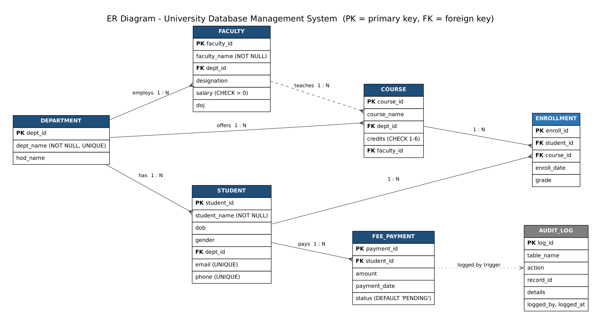

# University Database Management System – BCSE302L Case Study 1

A relational database for a university, built in **MySQL 8.0** for the BCSE302L (Database Systems) case study. The `university_db` schema has seven tables. `DEPARTMENT` is the parent of `FACULTY`, `STUDENT` and `COURSE`. Each course may be taught by one faculty member. `ENROLLMENT` links students to courses and stores the grade. `FEE_PAYMENT` records each student's fee payments with a `PENDING`/`PAID`/`FAILED` status. `AUDIT_LOG` is filled automatically by a trigger whenever a new fee payment is recorded. The scripts build the schema and load sample data, then show constraints, single-row and group functions, joins, subqueries and views, and finally stored procedures, functions, cursors and triggers. The output of every script is saved in `outputs/`.

## ER Diagram



The Graphviz source is in [`er_diagram.dot`](er_diagram.dot).

## Scripts

| Script | Covers |
|---|---|
| `01_ddl.sql` | Section 1: creates `university_db` and all 7 tables with PRIMARY KEY, FOREIGN KEY (with `ON DELETE CASCADE` / `SET NULL`), NOT NULL, UNIQUE, CHECK and DEFAULT constraints |
| `02_dml.sql` | Sample data for departments, faculty, students, courses, enrollments and fee payments |
| `03_constraint_tests.sql` | Section 1: inserts that are meant to fail, one for each constraint (run with `--force`) |
| `04_single_row_functions.sql` | Section 2: string, date and numeric functions (`UPPER`, `CHAR_LENGTH`, `SUBSTRING_INDEX`, `TIMESTAMPDIFF`, `DATE_FORMAT`, `ROUND` vs `TRUNCATE`) |
| `05_operators_group_functions.sql` | Section 3: `IN`, `BETWEEN`, `COUNT`/`SUM`, `GROUP BY`, `HAVING` |
| `06_joins_subqueries_views.sql` | Section 4: INNER and LEFT joins, `NOT EXISTS`, correlated subqueries, and the `STUDENT_FEE_STATUS` view |
| `07_procedures_functions_cursors_triggers.sql` | Section 5: `enroll_student` procedure, `get_student_age` function, cursor-based `faculty_salary_hike` procedure, plus the `trg_prevent_duplicate_enrollment` and `trg_fee_payment_audit` triggers |
| `08_section5_demo.sql` | Section 5: sample calls for the procedures, function, cursor and triggers, including the expected error cases |
| `run_all.sh` | Rebuilds the database from scratch and writes each script's output to `outputs/` |

## How to Run

1. Install **MySQL 8.0** (the scripts use `CHECK` constraints and expression defaults, which need 8.0.16+) and make sure the `mysql` client is on your `PATH`.
2. Run everything with:

   ```bash
   ./run_all.sh
   ```

   The script connects as `root` with no password (`mysql -uroot`). If your root account has a password, add `-p` to the `mysql` lines in `run_all.sh` or set up a `~/.my.cnf`.

3. Or run the scripts by hand, in order:

   ```bash
   mysql -uroot -p < 01_ddl.sql
   mysql -uroot -p < 02_dml.sql
   mysql -uroot -p --force < 03_constraint_tests.sql
   mysql -uroot -p < 04_single_row_functions.sql
   mysql -uroot -p < 05_operators_group_functions.sql
   mysql -uroot -p < 06_joins_subqueries_views.sql
   mysql -uroot -p < 07_procedures_functions_cursors_triggers.sql
   mysql -uroot -p --force < 08_section5_demo.sql
   ```

   `03` and `08` include statements that are meant to fail, so they need `--force` to keep going after each error.

## Features Covered

- **Constraints**: PRIMARY KEY, FOREIGN KEY (CASCADE / SET NULL), NOT NULL, UNIQUE, CHECK, DEFAULT
- **Single-row functions**: string, date and numeric functions
- **Group functions**: `COUNT`, `SUM`, `AVG` with `GROUP BY` / `HAVING`
- **Joins**: INNER JOIN, LEFT JOIN
- **Subqueries**: `NOT EXISTS`, correlated subqueries
- **Views**: `STUDENT_FEE_STATUS`
- **Stored procedures**: `enroll_student`, `faculty_salary_hike`
- **Functions**: `get_student_age`
- **Cursors**: used in `faculty_salary_hike` to give a 10% hike to faculty with 5+ years of service
- **Triggers**: `trg_prevent_duplicate_enrollment` (BEFORE INSERT) and `trg_fee_payment_audit` (AFTER INSERT, writes to `AUDIT_LOG`)

## Author

Pratyush Rai (24BDS0170)
